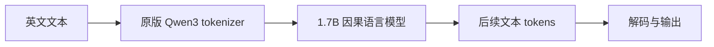

# Meridian Text 1.7B

面向英文 STEM 预训练研究的轻量文本模型发行版：完整权重、简单补全文本入口、论文评估代码放在一起，方便下载和继续研究。

**本项目重新整理 QVAC Genesis III Combined 的代码与权重。权重保持原样，由 Tether AI Research 训练；Yifan Ouyang 维护此发行版与使用入口。它是基座模型，未经聊天或指令训练。**

[下载完整权重](https://huggingface.co/yifanouyang/Meridian-Text-1.7B) · [原论文](https://arxiv.org/abs/2609.19513) · [来源与许可](docs/PROVENANCE.md)

## 开始使用

需要 Python 3.10+；首次运行会下载约 3.46 GB 模型文件。CPU 可加载，生成速度取决于机器；GPU/BF16 更适合研究。

```bash
git clone https://github.com/yifan-2004/Meridian-Text-1.7B.git
cd Meridian-Text-1.7B
pip install -r requirements.txt
python scripts/complete.py --prompt "Photosynthesis is the process by which" --device cpu
# 支持 CUDA 的机器：
python scripts/complete.py --prompt "The answer is" --device cuda
```

只下载，留待离线使用：

```bash
hf download yifanouyang/Meridian-Text-1.7B --local-dir weights
python scripts/complete.py --model ./weights --prompt "The scientific method begins with"
```

这是文本续写入口，不使用聊天模板，也不执行模型仓库中的自定义 Python 代码。`--help` 不加载模型或联网。

## 模型与能力范围

| 项目 | 说明 |
|---|---|
| 参数规模 | 约 1.7B |
| 架构 | Qwen3ForCausalLM，28 层，hidden size 2048，16 attention / 8 KV heads |
| 权重精度 | BF16，完整 safetensors checkpoint |
| 训练 | 从随机参数开始，在 Genesis III 的 FA+OL 合成 STEM 语料上预训练 |
| 语言与上下文 | 英文；训练上下文 4,096 tokens |
| 适用 | 预训练数据研究、文本续写、进一步预训练与后训练 |
| 限制 | 未经过聊天、指令、偏好或安全对齐；可能重复、答非所问或产生错误内容 |

配置中的位置容量为 32,768；本项目不宣称已验证 32K 长上下文效果，也不把它描述为可直接交付的助手。



## 论文报告的结果

以下为**原作者报告**的 Combined checkpoint 结果，本项目没有重新运行评估。原协议是生成回答后，由 CompassJudger-2-32B 解析最终选项。

| 指标 | 上游结果 |
|---|---:|
| ARC-Easy Accuracy | 51.85% |
| ARC-Challenge Accuracy | 42.71% |
| GPQA Diamond Accuracy | 22.72% |
| MMLU STEM Accuracy | 30.19% |
| MMLU STEM Valid Answer Rate | 92.06% |

[原模型卡](docs/UPSTREAM_MODEL_CARD.md)给出训练细节与评估范围。`research/evaluation/` 保留上游 OpenCompass 评估实现，默认配置需要约 8×80 GB GPU 并会加载额外的 32B judge；它不是快速开始的依赖。评估前请阅读该目录 README，并根据硬件修改模型及并行配置。

## 目录

```text
scripts/complete.py           简单文本补全入口
research/evaluation/         上游研究评估代码与配置
research/assets/             原作者论文图示
configs/                     发行版模型信息
examples/                    可自行尝试的输入（无伪造输出）
docs/                        原模型卡、来源、许可证与权重校验信息
```

## 校验与许可

权重：[model.safetensors](https://huggingface.co/yifanouyang/Meridian-Text-1.7B/resolve/main/model.safetensors)，3,441,185,576 bytes。

```text
SHA-256 9d82a616936da8c0fed035fae06f90db9dd00cae63d73efd71a41b3e7b954f8b
```

镜像与来源的全部 safetensors 文件大小及 LFS SHA-256 元数据一致，见 [manifest](docs/weights-manifest.json)。尚未在本机加载权重、执行推理或复现论文结果。

代码及模型权重为 Apache-2.0；保留上游署名、[代码许可证](LICENSE)、[模型许可证](docs/MODEL_LICENSE)及[模型归属声明](docs/MODEL_ATTRIBUTIONS.md)。Genesis III **数据集**单独采用 CC-BY-NC 4.0，此仓库不分发数据集。模型原架构标识、tokenizer 特殊 tokens 与评估协议名称保留，以保证兼容。
