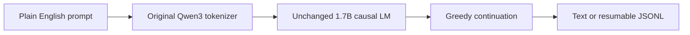

# Model reference

| Field | Value |
|---|---|
| Upstream | QVAC Genesis III Combined, Tether AI Research |
| Parameters | Approximately 1.7B |
| Architecture | Qwen3ForCausalLM; 28 layers; hidden size 2048; 16 attention / 8 KV heads |
| Weights | Complete BF16 safetensors checkpoint |
| Training | From random initialization on FA+OL synthetic STEM data |
| Language | English |
| Training context | 4,096 tokens |
| Scope | Text completion, pretraining-data research, downstream training |
| Limitations | No chat, instruction, preference, or safety alignment; possible repetition and incorrect outputs |

The config permits 32,768 positions; this is not evidence of validated 32K-context quality.



## Upstream-reported results

| Metric | Original Combined checkpoint |
|---|---:|
| ARC-Easy Accuracy | 51.85% |
| ARC-Challenge Accuracy | 42.71% |
| GPQA Diamond Accuracy | 22.72% |
| MMLU STEM Accuracy | 30.19% |
| MMLU STEM Valid Answer Rate | 92.06% |

Source: [original paper](https://arxiv.org/abs/2609.19513), [original model card](UPSTREAM_MODEL_CARD.md). The protocol generates candidate answers and uses CompassJudger-2-32B to extract final choices. We have not reproduced these results. Our regression fixes change edge-case answer handling, so modified-code scores must be measured separately before comparison.

## Audited fixes

The inherited postprocessor counted an empty prediction against an empty gold as correct. It also forwarded reasoning text when a closing reasoning tag had no final answer, selected the wrong closing tag with mixed tag families, and missed unclosed reasoning preceded by whitespace. These now return invalid/no-answer results or use the latest closing tag as appropriate. Offline regression tests cover these cases and normal final-answer behavior.

Other inherited evaluation code is retained; syntax checks and focused postprocessing tests are not a full OpenCompass compatibility audit or benchmark reproduction.

## Weight integrity

`model.safetensors`: 3,441,185,576 bytes.

```text
SHA-256 9d82a616936da8c0fed035fae06f90db9dd00cae63d73efd71a41b3e7b954f8b
```

The mirror and upstream LFS metadata matched for every safetensors file. See [manifest](weights-manifest.json) for source revision and verification scope. No full checkpoint inference was performed for this toolkit update.
