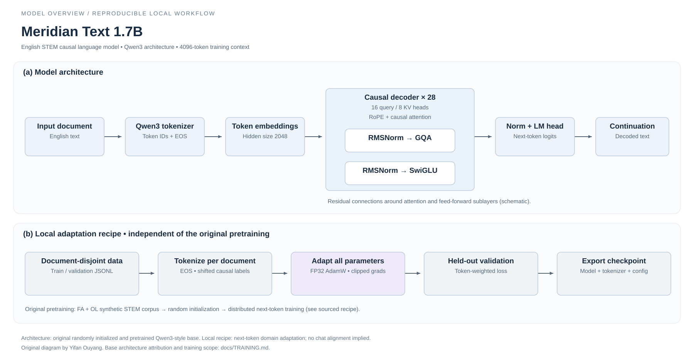

# Train Meridian Text 1.7B



Two separate workflows: the upstream checkpoint's pretraining, and this toolkit's runnable downstream domain adaptation. Mirrored weights remain unchanged.

## Original pretraining (reported by Tether AI Research)

| Stage | Configuration |
| --- | --- |
| Initialize | Random Qwen3-1.7B architecture; not continued Qwen pretrained weights |
| Data | Genesis III Failure Analysis + Option-Level, 191.43B tokens |
| Input | Packed 4,096-token sequences; attention resets at document boundaries |
| Optimize | AdamW, BF16, batch 2,048 sequences; cosine LR 2e-4 → 2e-5, 10% warmup |
| Run | One epoch, 22,819 steps; 64 × H100 80 GB, Megatron-Core/Bridge |
| Evaluate | ARC, GPQA Diamond, MMLU STEM using the paper's answer-parser protocol |

Source: [original model card](UPSTREAM_MODEL_CARD.md#-training) and [paper](https://arxiv.org/abs/2609.19513). This toolkit does not reproduce that distributed pretraining pipeline. The corpus has a separate CC-BY-NC 4.0 license.

## Domain adaptation with your own text

1. Split by source document **before** creating JSONL. Each row needs `document_id` and `text`; keep related pages/chunks in the same split. The loader rejects repeated IDs/text and cross-split exact normalized-text overlaps; it cannot detect semantic duplicates.
2. Install [runtime dependencies](../requirements.txt). Start with a short run; the bundled toy texts only verify the pipeline.
3. Train, validate, and save a separate checkpoint:

```bash
python scripts/train.py --device cuda \
  --train examples/training/train.jsonl \
  --validation examples/training/validation.jsonl \
  --output checkpoints/meridian-domain \
  --max-length 512 --batch-size 1 --max-steps 20 \
  --learning-rate 2e-5 --weight-decay 0.01 --seed 42
```

This is full-parameter causal next-token training in FP32, constant-LR AdamW, gradient clipping at 1.0. Each document is truncated to `max-length - 1` tokens then receives EOS; documents remain separate, and padding is excluded from loss. There is no chat tuning, packing, mixed precision, distributed training, or resume support. Full 1.7B training requires considerably more memory than inference: optimizer states and gradients also reside on the selected device. Select smaller lengths or a smaller `--model` for a hardware smoke test; no 1.7B training-memory claim is made.

4. Inspect `training_config.json`, per-step `training_log.jsonl`, and token-weighted held-out `metrics.json`. Nonfinite loss/gradients abort training; existing nonempty output directories are rejected. Successful runs save Transformers/Safetensors model and tokenizer files.
5. Load the saved checkpoint locally:

```bash
python scripts/complete.py --model checkpoints/meridian-domain --offline \
  --device cuda --prompt "Photosynthesis is"
```

Compare held-out loss and task results with the unchanged base using identical prompts/protocols. Record dataset rights, split rules, checkpoint revision (`--revision`), hardware and logs before claiming improvements. The short example is a functional check, not evidence of model quality. Seeded shuffling is reproducible; bitwise GPU reproducibility is not guaranteed.

## Offline verification

```bash
python -m unittest discover -s tests -v
python tests/smoke_tiny_training.py
```

The optional integration test creates random tiny Qwen3 weights locally, performs a real CPU optimizer step and validation, saves and reloads the checkpoint. It downloads nothing and does not train the 1.7B model.
